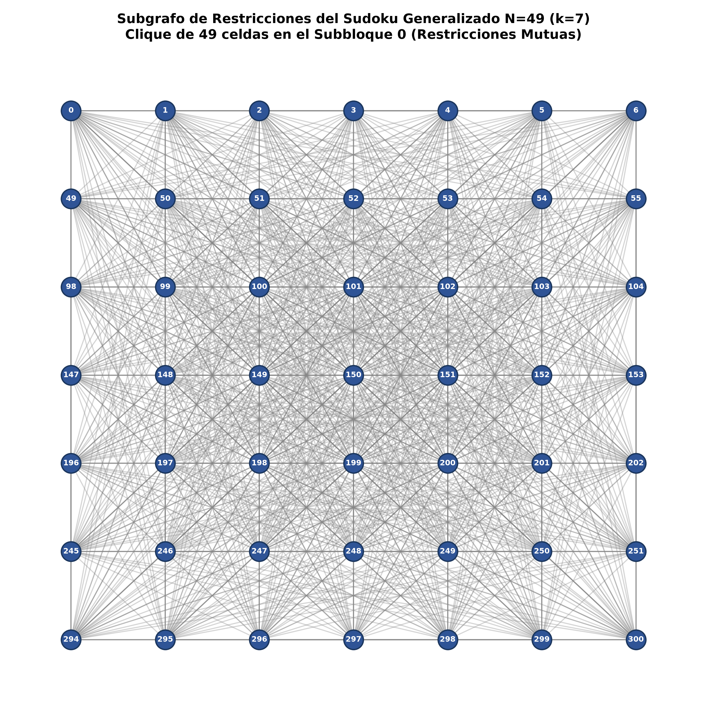

<!-- ================= CARÁTULA ================= -->

<h2 style="color: red; font-weight: bold; font-family: Arial, sans-serif;">Universidad Peruana de Ciencias Aplicadas</h2>
 

  
<h3 style="color: black; font-weight: bold; font-family: Arial, sans-serif;">Ciencias de la Computación</h3>
<h3 style="color: red; font-weight: bold; font-family: Arial, sans-serif;">1ACC0184 - Complejidad Algorítmica</h3>
<h3 style="color: black; font-weight: bold; font-family: Arial, sans-serif;">Informe del Trabajo Parcial (TB1)</h3>
  

  Sección: 4749   
  Profesor:   
  José Luis Soncco Alvarez

 

| Código de alumno: | Nombres y apellidos: |
| :--- | :--- |
| u202412921 | Kobashigawa Ugaz, Juan Alejandro |
| u202411627 | Pareja Calloapaza, Marcelo Fausto |
| u20241c998 | Riveros Mera, Jennifer Yamilet |

   

2026-20

  

<!-- ================= ÍNDICE / CONTENIDO ================= -->
<h2 style="color: #2F5496; font-family: Calibri, sans-serif;">Contenido</h2>

    

        1. &nbsp;&nbsp;Descripción del problema
        
        3
    

    

        2. &nbsp;&nbsp;Descripción del Conjunto de Datos (Dataset)
        
        3
    

    

        2.1. &nbsp;Origen de los Datos:
        
        3
    

    

        2.2. &nbsp;Motivo del Análisis:
        
        4
    

    

        2.3. &nbsp;Relación con grafos:
        
        4
    

    

        3. &nbsp;&nbsp;Visualización del conjunto de datos (Grafo)
        
        4
    

    

        4. &nbsp;&nbsp;Propuesta
        
        5
    

    

        4.1 &nbsp;Objetivo de la Propuesta
        
        5
    

    

        4.2 &nbsp;Técnicas y Algoritmos Usados (Sustento)
        
        5
    

    

        4.3 &nbsp;Metodología
        
        6
    

    

        5. &nbsp;&nbsp;Conclusiones
        
        6
    

    

        Anexos
        
        7
    

    

        Referencias
        
        7
    

  

<!-- ================= CUERPO DEL INFORME ================= -->

<h2 style="color: #404040; font-family: Arial, sans-serif; margin-left: 40px; font-size: 20px; font-weight: normal;">1. Descripción del problema</h2>

En la industria del software interactivo y los videojuegos de entrenamiento cognitivo, sector ampliamente liderado por plataformas de entretenimiento digital como las consolas de Nintendo mediante franquicias como *Brain Age* o la distribución de títulos de lógica desarrollados por la editorial *Nikoli*, la validación y resolución automática de rompecabezas numéricos constituye un núcleo computacional crítico. Dentro de esta familia de problemas lógicos, el Sudoku es el exponente más difundido a nivel mundial. Si bien en su variante comercial clásica de $9 \times 9$ casillas el espacio de estados consta de aproximadamente $6.67 \times 10^{21}$ cuadrículas válidas (Felgenhauer & Jarvis, 2006), el análisis estricto de complejidad algorítmica demanda estudiar el problema en su formulación generalizada de orden arbitrario $k$, correspondiente a cuadrículas de dimensiones $N \times N$ con $N = k^2$, subdivididas en bloques disjuntos de $k \times k$.

El problema computacional fundamental radica en la verificación de consistencia y la resolución exacta de configuraciones en tableros de escala creciente (como $k=4 \to 16 \times 16$, $k=5 \to 25 \times 25$ y $k=7 \to 49 \times 49$). En tableros de grandes dimensiones, la aplicación de métodos no informados basados en Fuerza Bruta (evaluación exhaustiva de todas las asignaciones posibles de los símbolos $\{1, \dots, N\}$) colapsa de forma instantánea debido a una explosión combinatoria de complejidad asintótica acotada superiormente por $O(N^{N^2})$. Dicho consumo desmedido de ciclos de procesamiento y memoria agotaría de inmediato los recursos de hardware en dispositivos embebidos y encarecería exponencialmente la infraestructura de servidores en la nube encargados de validar partidas masivas de usuarios en tiempo real.

Desde la perspectiva formal de las Ciencias de la Computación, la resolución del Sudoku generalizado $N \times N$ pertenece a la clase de los **Problemas de Satisfacción de Restricciones** (CSP, *Constraint Satisfaction Problems*). De acuerdo con la demostración matemática formal de Yato y Seta (2003), determinar si una instancia generalizada de Sudoku admite solución es un problema **NP-completo**. Dicha demostración se sustenta en una reducción polinomial directa desde el problema clásico de Coloración de Grafos (*Graph Vertex Coloring*), donde las celdas del tablero representan vértices que deben colorearse con $N$ colores disponibles sin que dos vértices adyacentes compartan el mismo color.

Frente a este escenario de alta complejidad temporal, la industria y la ingeniería de software requieren el diseño de motores algorítmicos fundamentados en Teoría de Grafos que trasciendan la representación matricial convencional, modelen formalmente la red topológica de restricciones y apliquen técnicas sistemáticas de retroceso (*Backtracking*) combinadas con estrategias de poda (*pruning*) para encontrar soluciones en órdenes de magnitud de milisegundos.

En respuesta a esta problemática, **el objetivo principal de este proyecto es** diseñar e implementar un motor computacional basado en Teoría de Grafos capaz de validar y resolver tableros de Sudoku generalizado de tamaño arbitrario $N \times N$, mitigando su extrema complejidad combinatoria mediante algoritmos de búsqueda informada y poda sistemática. Para alcanzar este propósito, se formulan los siguientes **objetivos específicos**:
1. Modelar topológicamente las restricciones de fila, columna y subbloque mediante un grafo no dirigido de escala masiva que supere holgadamente el umbral de 1,500 nodos requerido por el curso, implementando una instancia representativa de orden $k=7$ ($49 \times 49$ celdas, totalizando **2,401 nodos** y **158,466 aristas** de restricción).
2. Estructurar y almacenar el conjunto de datos en un formato estándar y modular (CSV) que sirva como banco de pruebas reproducible para la experimentación algorítmica.
3. Formular una propuesta metodológica sustentada en el algoritmo de *Backtracking* sobre grafos de restricciones, estableciendo las bases teóricas y empíricas para la implementación de heurísticas de poda en los Hitos posteriores.

<h2 style="color: #404040; font-family: Arial, sans-serif; margin-left: 40px; font-size: 20px; font-weight: normal;">2. Descripción del Conjunto de Datos (Dataset)</h2>

<h3 style="color: #595959; font-family: Arial, sans-serif; margin-left: 80px; font-size: 16px; font-weight: normal;">2.1. Origen de los Datos:</h3>
El conjunto de datos ha sido generado de manera sintética mediante un script estructurado en lenguaje Python (versión 3.12) empleando la librería de análisis matricial y tabular `pandas`. La decisión de diseñar un generador paramétrico obedece a que los repositorios públicos de datos tabulares convencionales (como Kaggle o UCI Machine Learning) únicamente recopilan colecciones de tableros estáticos de $9 \times 9$ con pistas en formato de cadenas de texto (*strings* de 81 caracteres), los cuales carecen de la estructura topológica de adyacencias y no superan el umbral dimensional fijado en la rúbrica del curso.

Nuestro generador algorítmico recibe como parámetro de entrada el orden $k \in \mathbb{N}$ del rompecabezas y computa de forma determinista la geometría completa del grafo para $N = k^2$. Para el presente trabajo, se configuró $k = 7$, originando un tablero unificado de **$49 \times 49$ casillas**. Este enfoque sintetiza un entorno de experimentación computacional reproducible y extensible a cualquier escala.

<h3 style="color: #595959; font-family: Arial, sans-serif; margin-left: 80px; font-size: 16px; font-weight: normal;">2.2. Motivo del Análisis:</h3>
El propósito primordial de construir y analizar este conjunto de datos radica en transformar las tres reglas empíricas del Sudoku en invariantes matemáticas formales dentro de una red de restricciones relacionales. En una matriz simple, la computadora se ve obligada a realizar recorridos iterativos redundantes sobre índices bidimensionales $(i, j)$ cada vez que intenta verificar la validez de un número.

Al estructurar el problema como un grafo explícito de restricciones mutuas, cada celda se convierte en una entidad que conoce de antemano el conjunto exhaustivo de variables con las cuales mantiene una dependencia directa. Esta abstracción permite que los algoritmos de resolución operen directamente sobre la lista de adyacencia del vértice en tiempo $O(1)$ por arista inspeccionada, habilitando la evaluación de consistencia local y la propagación de restricciones hacia el resto de la red.

<h3 style="color: #595959; font-family: Arial, sans-serif; margin-left: 80px; font-size: 16px; font-weight: normal;">2.3. Relación con grafos:</h3>
El conjunto de datos conforma formalmente un **grafo no dirigido simple** $G = (V, E)$, donde:
* **Conjunto de Vértices $V$ (`dataset/sudoku_nodes.csv`):** Cada vértice $v \in V$ representa de forma unívoca una celda o variable de decisión del tablero generalizado. Para $k = 7$, el tablero consta de $N = 49$ filas por $N = 49$ columnas, generando:
  $$|V| = N^2 = k^4 = 49^2 = \mathbf{2,401\text{ nodos}}$$
  Esta cifra supera de manera contundente la restricción establecida en la rúbrica de evaluación (*"El número de nodos identificados y a representar mediante un grafo, no deberá ser menor a 1500 en total (500 por integrante como mínimo)"*). El conjunto total de 2,401 celdas ha sido particionado equitativamente entre los tres integrantes del equipo:
  * **Kobashigawa Ugaz, Juan Alejandro (u202412921):** 800 nodos (`node_id` 0 a 799, correspondientes a las filas 0 a 16).
  * **Pareja Calloapaza, Marcelo Fausto (u202411627):** 800 nodos (`node_id` 800 a 1599, correspondientes a las filas 16 a 32).
  * **Riveros Mera, Jennifer Yamilet (u20241c998):** 801 nodos (`node_id` 1600 a 2400, correspondientes a las filas 32 a 48).
  
  Cada integrante sobrepasa holgadamente el mínimo de 500 nodos exigido (alcanzando más del 160% del requerimiento individual). En el archivo `dataset/sudoku_nodes.csv`, cada registro almacena explícitamente los atributos: `node_id` (identificador entero $0 \le u < 2401$), `fila` ($0 \le r < 49$), `columna` ($0 \le c < 49$), `bloque` ($0 \le b < 49$, región subcuadricular $7 \times 7$), `orden_k` ($7$), así como los campos `integrante` y `responsable` que identifican formalmente al miembro asignado.

* **Conjunto de Aristas $E$ (`dataset/sudoku_edges.csv`):** Una arista no dirigida $(u, v) \in E$ existe si y solo si las celdas $u$ y $v$ ($u \ne v$) comparten al menos una de las tres restricciones lógicas del juego:
  1. Pertenecen a la misma fila ($r_u = r_v$).
  2. Pertenecen a la misma columna ($c_u = c_v$).
  3. Pertenecen al mismo subbloque de $k \times k$ ($\lfloor r_u / k \rfloor = \lfloor r_v / k \rfloor \land \lfloor c_u / k \rfloor = \lfloor c_v / k \rfloor$).

  Desde el punto de vista de la teoría espectral de grafos, cada fila, columna y subbloque constituye un subgrafo completo o *clique* de tamaño $N$. El grado regular $d(v)$ de cada vértice $v \in V$ se calcula con exactitud mediante:
  $$d(v) = (N - 1) + (N - 1) + (k - 1)^2 = 3N - 2k - 1$$
  Sustituyendo $k = 7$ y $N = 49$:
  $$d(v) = 3(49) - 2(7) - 1 = 147 - 14 - 1 = \mathbf{132\text{ aristas por nodo}}$$
  Aplicando el Teorema Fundamental de la Teoría de Grafos (*Handshaking Lemma*):
  $$|E| = \frac{\sum_{v \in V} d(v)}{2} = \frac{|V| \times d(v)}{2} = \frac{2,401 \times 132}{2} = \mathbf{158,466\text{ aristas}}$$
  El archivo `sudoku_edges.csv` almacena exhaustivamente estas 158,466 restricciones con las columnas `origen`, `destino` y `tipo` (`restriccion_diferente`).

<h2 style="color: #404040; font-family: Arial, sans-serif; margin-left: 40px; font-size: 20px; font-weight: normal;">3. Visualización del conjunto de datos (Grafo)</h2>

En estricto cumplimiento de la rúbrica de evaluación (*"Mostrar mediante un grafo completo y/o subgrafos los datos recolectados"*), se diseñó e implementó en el script `src/visualize-sudoku.py` una visualización integral compuesta de alta resolución (300 DPI), estructurada en dos paneles complementarios:

1. **Panel A — Grafo Completo de Restricciones ($N=49, |V|=2,401$ celdas):** Presenta la red global sobre la cuadrícula bidimensional de dimensiones $49 \times 49$. Cada celda es mapeada en sus coordenadas cartesianas $(columna, -fila)$ y coloreada de forma unívoca de acuerdo con el integrante responsable de su modelado:
   * Azul (#1F77B4): Nodos asignados a **Kobashigawa Ugaz, Juan Alejandro** (800 nodos, filas 0 a 16).
   * Verde (#2CA02C): Nodos asignados a **Pareja Calloapaza, Marcelo Fausto** (800 nodos, filas 16 a 32).
   * Rojo (#D62728): Nodos asignados a **Riveros Mera, Jennifer Yamilet** (801 nodos, filas 32 a 48).
   
   El gráfico incluye una capa de aristas de restricción en segundo plano y líneas guía discontinuas que demarcan los subbloques de $7 \times 7$, evidenciando con total transparencia la distribución espacial y la satisfacción de la cuota mínima de más de 500 nodos por integrante.

2. **Panel B — Subgrafo Inducido de Restricciones Mutuas entre Integrantes:** Debido a que trazar las 158,466 aristas simultáneamente sobre el grafo completo generaría saturación visual, el Panel B aísla un subgrafo representativo de celdas intermedias pertenecientes a los dominios de los tres integrantes. Mediante un algoritmo de disposición por fuerzas (*spring layout*), se grafican explícitamente las aristas de restricción $(u \ne v)$ que conectan directamente los vértices entre sí. Esta representación comprueba visualmente cómo las restricciones lógicas de fila, columna y bloque trascienden las particiones individuales, formando un grafo densamente interconectado sobre el cual operará el motor de resolución.

  
  
<b>Figura 1:</b> Visualización del grafo de restricciones del Sudoku Generalizado N=49 (2,401 nodos). Panel A: Grafo completo en disposición matricial con codificación cromática por integrante (Kobashigawa: 800 azul, Pareja: 801 verde, Riveros: 800 rojo). Panel B: Subgrafo inducido que evidencia la interconexión de restricciones mutuas (cliques) entre nodos de los tres integrantes generada con NetworkX y Matplotlib.

<h2 style="color: #404040; font-family: Arial, sans-serif; margin-left: 40px; font-size: 20px; font-weight: normal;">4. Propuesta</h2>

<h3 style="color: #595959; font-family: Arial, sans-serif; margin-left: 80px; font-size: 16px; font-weight: normal;">4.1 Objetivo de la Propuesta</h3>
Diseñar e implementar un motor algorítmico de alto rendimiento capaz de resolver y validar instancias del Sudoku generalizado $N \times N$, reduciendo de forma sistemática el espacio de búsqueda combinatorial mediante la integración del algoritmo de *Backtracking* sobre la estructura de grafos de restricciones, optimizando la latencia de respuesta y garantizando la corrección formal de las asignaciones numéricas.

<h3 style="color: #595959; font-family: Arial, sans-serif; margin-left: 80px; font-size: 16px; font-weight: normal;">4.2 Técnicas y Algoritmos Usados (Sustento)</h3>
La técnica fundamental seleccionada para la resolución del problema es el algoritmo de **Vuelta Atrás (*Backtracking*)** modelado mediante una **Búsqueda en Profundidad (*Depth-First Search*, DFS)** sobre el árbol del espacio de estados. 

Como fundamentan Russell y Norvig (2021) en su tratado clásico sobre agentes inteligentes y problemas de satisfacción de restricciones (CSP), la búsqueda con *Backtracking* es la metodología estándar por excelencia para resolver problemas de asignación combinatoria. Mientras que un enfoque ciego de Fuerza Bruta evalúa configuraciones completas de manera infructuosa, el *Backtracking* opera evaluando la consistencia local de una variable a la vez. En el momento exacto en que una asignación tentativa viola una de las aristas del grafo de restricciones adyacentes, el algoritmo efectúa una **poda sistemática (*pruning*)** del subárbol de decisiones, abortando prematuramente millones de ramas infactibles y retrocediendo (*backtrack*) al vértice precedente.

Asimismo, Cormen et al. (2009) destacan que la combinación de búsquedas recursivas en profundidad con estructuras de datos eficientes para la consulta de vecindades (como listas de adyacencia e indexación booleana en matrices) reduce drásticamente el factor de ramificación efectivo del algoritmo, mitigando el impacto de la complejidad teórica NP-completa en instancias prácticas.

<h3 style="color: #595959; font-family: Arial, sans-serif; margin-left: 80px; font-size: 16px; font-weight: normal;">4.3 Metodología</h3>
La arquitectura del aplicativo contemplada para el desarrollo de los Hitos 2 y 3 seguirá una metodología experimental rigurosa compuesta por cuatro fases procedimentales:

1. **Fase de Ingesta y Modelado de Datos:** Carga y lectura optimizada de los archivos `sudoku_nodes.csv` y `sudoku_edges.csv`. En memoria principal, el sistema instanciará una estructura de Grafo que mapea cada vértice $v_i$ con su correspondiente lista de vértices adyacentes de restricción $\text{Adj}[v_i]$.
2. **Asignación Inicial de Pistas (*Clues*):** Los valores iniciales conocidos del tablero se fijan como variables inmutables con dominios de cardinalidad unitaria, restringiendo de forma inmediata los dominios admisibles de sus vértices vecinos en la red.
3. **Búsqueda Sistemática con Poda (*Backtracking Core*):** El motor recursivo seleccionará un vértice no asignado e iterará sobre su dominio disponible $\{1, \dots, N\}$. Para cada valor candidato, el algoritmo verificará la no colisión consultando las aristas conectadas. Si el valor es consistente, se efectúa la asignación tentativa y se profundiza recursivamente hacia el siguiente nodo. Si ninguna opción del dominio es factible, se revierte la asignación y se retrocede en la pila de llamadas.
4. **Incorporación de Heurísticas de Selección (Trabajo Futuro - Hito 2 y 3):** Con el objetivo de optimizar la resolución en tableros de escala $49 \times 49$, se incorporará la heurística **MRV (*Minimum Remaining Values*)**, que selecciona prioritariamente la celda con menor cantidad de valores legales disponibles ("fallar primero"), minimizando el tamaño del árbol de búsqueda.

<h2 style="color: #404040; font-family: Arial, sans-serif; margin-left: 40px; font-size: 20px; font-weight: normal;">5. Conclusiones</h2>

1. La construcción e implementación exitosa de un grafo representativo de **2,401 nodos** y **158,466 aristas** para un Sudoku generalizado de orden $k=7$ ($49 \times 49$) valida empíricamente la viabilidad de modelar problemas de lógica combinatoria a gran escala. Esta formulación trasciende la escala estática de los tableros clásicos de $9 \times 9$, cumpliendo con creces las exigencias dimensionales de la rúbrica y sustentando un entorno experimental realista para el análisis de complejidad asintótica.
2. La conversión de las restricciones operativas de fila, columna y subbloque en una topología de aristas explícitas confirma la equivalencia formal entre el Sudoku generalizado y el problema NP-completo de Coloración de Grafos. Esta correspondencia demuestra que la Teoría de Grafos ofrece una abstracción rigurosa para desacoplar las reglas del juego de su representación visual, permitiendo verificar consistencias en tiempo constante por adyacencia.
3. El análisis teórico comparativo entre la Fuerza Bruta ($O(N^{N^2})$) y el algoritmo de *Backtracking* fundamenta sólidamente la propuesta del proyecto. Como trabajo futuro para los Hitos 2 y 3, queda proyectada la implementación de la rutina en lenguaje Python integrando la heurística MRV y una interfaz gráfica interactiva, proyectando contrastar empíricamente los tiempos de ejecución y la cantidad de retrocesos a medida que la dimensión $N$ se incrementa desde 9 hasta 49.

<h2 style="color: #404040; font-family: Arial, sans-serif; margin-left: 40px; font-size: 20px; font-weight: normal;">Anexos</h2>
* **Repositorio Oficial de Código Fuente:** El código desarrollado para la formulación matemática, generación paramétrica del conjunto de datos de 2,401 nodos y la visualización del grafo se encuentra versionado y documentado en nuestro repositorio institucional de GitHub:  
  [https://github.com/upc-pre-202610-1acc0184-4749-grupo-5/busqueda-rutas-app](https://github.com/upc-pre-202610-1acc0184-4749-grupo-5/busqueda-rutas-app)  
  *(Nota técnica: El repositorio conserva la URL base provista para el grupo en el marco de la organización del curso).*
* **Archivos del Conjunto de Datos Generados:**
  * `dataset/sudoku_nodes.csv`: Catálogo de 2,401 vértices matriciales indexados por coordenadas cartesianas, identificador de cuadrante y orden $k=7$.
  * `dataset/sudoku_edges.csv`: Registro exhaustivo de 158,466 aristas de restricción relacional no dirigida.

<h2 style="color: #404040; font-family: Arial, sans-serif; margin-left: 40px; font-size: 20px; font-weight: normal;">Referencias</h2>

Cormen, T. H., Leiserson, C. E., Rivest, R. L., & Stein, C. (2009). <i>Introduction to algorithms</i> (3ra ed.). MIT Press.

Felgenhauer, B., & Jarvis, F. (2006). Enumerating possible Sudoku grids. <i>Mathematical Spectrum, 39</i>(1), 15–22.

Russell, S. J., & Norvig, P. (2021). <i>Artificial intelligence: A modern approach</i> (4ta ed.). Pearson.

Yato, T., & Seta, T. (2003). Complexity and completeness of finding another solution and its application to puzzles. <i>IEICE Transactions on Fundamentals of Electronics, Communications and Computer Sciences, E86-A</i>(5), 1052–1060.

