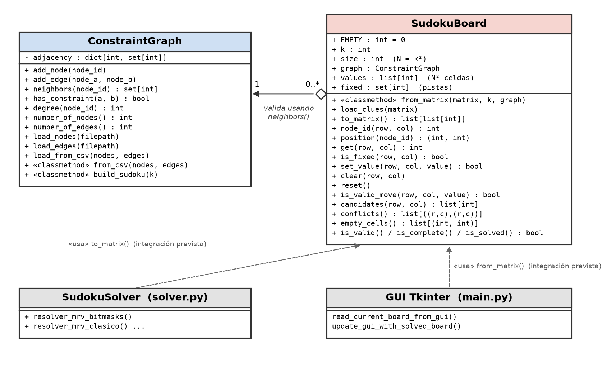

<!-- ================= CARÁTULA ================= -->

<h2 style="color: red; font-weight: bold; font-family: Arial, sans-serif;">Universidad Peruana de Ciencias Aplicadas</h2>
 

  
<h3 style="color: black; font-weight: bold; font-family: Arial, sans-serif;">Ciencias de la Computación</h3>
<h3 style="color: red; font-weight: bold; font-family: Arial, sans-serif;">1ACC0184 - Complejidad Algorítmica</h3>
<h3 style="color: black; font-weight: bold; font-family: Arial, sans-serif;">Informe del Segundo Hito (TB2)</h3>
  

  Sección: 4749   
  Profesor:   
  José Luis Soncco Alvarez

 

| Código de alumno: | Nombres y apellidos: |
| :--- | :--- |
| u202411627 | Pareja Calloapaza, Marcelo Fausto |
| u202412921 | Kobashigawa Ugaz, Juan Alejandro |
| u20241c998 | Riveros Mera, Jennifer Yamilet |

   

2026-20

  

<!-- ================= ÍNDICE / CONTENIDO ================= -->
<h2 style="color: #2F5496; font-family: Calibri, sans-serif;">Contenido</h2>

    

        1. &nbsp;&nbsp;Descripción del problema
        
        3
    

    

        2. &nbsp;&nbsp;Descripción del Conjunto de Datos (Dataset)
        
        3
    

    

        2.1. &nbsp;Origen de los Datos
        
        3
    

    

        2.2. &nbsp;Motivo del Análisis
        
        4
    

    

        2.3. &nbsp;Relación con grafos y partición por integrante
        
        4
    

    

        3. &nbsp;&nbsp;Propuesta
        
        5
    

    

        3.1. &nbsp;Objetivo de la Propuesta
        
        5
    

    

        3.2. &nbsp;Técnicas y Algoritmos Seleccionados
        
        5
    

    

        3.3. &nbsp;Metodología Experimental
        
        6
    

    

        4. &nbsp;&nbsp;Diseño del Aplicativo
        
        6
    

    

        4.1. &nbsp;Análisis de Algoritmos y Complejidad (Pareja, M.)
        
        6
    

    

        4.2. &nbsp;Arquitectura de Datos y Modelado (Riveros, J.)
        
        9
    

    

        4.3. &nbsp;Etapas de Ingeniería de Software y GUI (Kobashigawa, J.)
        
        10
    

    

        Anexos
        
        11
    

    

        Referencias
        
        11
    

  

<!-- ================= CUERPO DEL INFORME ================= -->

<h2 style="color: #404040; font-family: Arial, sans-serif; margin-left: 40px; font-size: 20px; font-weight: normal;">1. Descripción del problema</h2>

En la industria del software interactivo y los videojuegos de entrenamiento cognitivo —sector ampliamente liderado por plataformas de entretenimiento digital como las consolas de Nintendo mediante franquicias como *Brain Age* o la distribución de títulos de lógica desarrollados por la editorial *Nikoli*—, la validación y resolución automática de rompecabezas numéricos constituye un núcleo computacional crítico. Dentro de esta familia de problemas lógicos, el Sudoku es el exponente más difundido a nivel mundial. Si bien en su variante comercial clásica de $9 \times 9$ casillas el espacio de estados consta de aproximadamente $6.67 \times 10^{21}$ cuadrículas válidas (Felgenhauer & Jarvis, 2006), el análisis estricto de complejidad algorítmica demanda estudiar el problema en su formulación generalizada de orden arbitrario $k$, correspondiente a cuadrículas de dimensiones $N \times N$ con $N = k^2$, subdivididas en bloques disjuntos de $k \times k$.

El problema computacional fundamental radica en la verificación de consistencia y la resolución exacta de configuraciones en tableros de escala creciente (como $k=4 \to 16 \times 16$, $k=5 \to 25 \times 25$ y $k=7 \to 49 \times 49$). En tableros de grandes dimensiones, la aplicación de métodos no informados basados en Fuerza Bruta (evaluación exhaustiva de todas las asignaciones posibles de los símbolos $\{1, \dots, N\}$) colapsa de forma instantánea debido a una explosión combinatoria de complejidad asintótica acotada superiormente por $O(N^{N^2})$. Dicho consumo desmedido de ciclos de procesamiento y memoria agotaría de inmediato los recursos de hardware en dispositivos embebidos y encarecería exponencialmente la infraestructura de servidores en la nube encargados de validar partidas masivas de usuarios en tiempo real.

Desde la perspectiva formal de las Ciencias de la Computación, la resolución del Sudoku generalizado $N \times N$ pertenece a la clase de los **Problemas de Satisfacción de Restricciones** (CSP, *Constraint Satisfaction Problems*). De acuerdo con la demostración matemática formal de Yato y Seta (2003), determinar si una instancia generalizada de Sudoku admite solución es un problema **NP-completo**. Dicha demostración se sustenta en una reducción polinomial directa desde el problema clásico de Coloración de Grafos (*Graph Vertex Coloring*), donde las celdas del tablero representan vértices que deben colorearse con $N$ colores disponibles sin que dos vértices adyacentes compartan el mismo color.

Frente a este escenario de alta complejidad temporal, la industria y la ingeniería de software requieren el diseño de motores algorítmicos fundamentados en Teoría de Grafos que trasciendan la representación matricial convencional, modelen formalmente la red topológica de restricciones y apliquen técnicas sistemáticas de retroceso (*Backtracking*) combinadas con estrategias de poda (*pruning*) para encontrar soluciones en órdenes de magnitud de milisegundos.

En respuesta a esta problemática, **el objetivo principal de este proyecto es** diseñar e implementar un motor computacional basado en Teoría de Grafos capaz de validar y resolver tableros de Sudoku generalizado de tamaño arbitrario $N \times N$, mitigando su extrema complejidad combinatoria mediante algoritmos de búsqueda informada y poda sistemática. Para alcanzar este propósito, se formulan los siguientes **objetivos específicos**:
1. Modelar topológicamente las restricciones de fila, columna y subbloque mediante un grafo no dirigido de escala masiva que supere holgadamente el umbral de 1,500 nodos requerido por el curso, implementando una instancia representativa de orden $k=7$ ($49 \times 49$ celdas, totalizando **2,401 nodos** y **158,466 aristas** de restricción).
2. Estructurar y almacenar el conjunto de datos en un formato estándar y modular (CSV) que sirva como banco de pruebas reproducible para la experimentación algorítmica.
3. Formular una propuesta metodológica sustentada en el algoritmo de *Backtracking* sobre grafos de restricciones, estableciendo las bases teóricas y empíricas para la implementación de heurísticas de poda en los Hitos posteriores.

<h2 style="color: #404040; font-family: Arial, sans-serif; margin-left: 40px; font-size: 20px; font-weight: normal;">2. Descripción del Conjunto de Datos (Dataset)</h2>

<h3 style="color: #595959; font-family: Arial, sans-serif; margin-left: 80px; font-size: 16px; font-weight: normal;">2.1. Origen de los Datos:</h3>
El conjunto de datos ha sido generado de manera sintética mediante un script estructurado en lenguaje Python (versión 3.12) empleando la librería de análisis matricial y tabular `pandas`. La decisión de diseñar un generador paramétrico obedece a que los repositorios públicos de datos tabulares convencionales (como Kaggle o UCI Machine Learning) únicamente recopilan colecciones de tableros estáticos de $9 \times 9$ con pistas en formato de cadenas de texto (*strings* de 81 caracteres), los cuales carecen de la estructura topológica de adyacencias y no superan el umbral dimensional fijado en la rúbrica del curso.

Nuestro generador algorítmico recibe como parámetro de entrada el orden $k \in \mathbb{N}$ del rompecabezas y computa de forma determinista la geometría completa del grafo para $N = k^2$. Para el presente trabajo, se configuró $k = 7$, originando un tablero unificado de **$49 \times 49$ casillas**. Este enfoque sintetiza un entorno de experimentación computacional reproducible y extensible a cualquier escala.

<h3 style="color: #595959; font-family: Arial, sans-serif; margin-left: 80px; font-size: 16px; font-weight: normal;">2.2. Motivo del Análisis:</h3>
El propósito primordial de construir y analizar este conjunto de datos radica en transformar las tres reglas empíricas del Sudoku en invariantes matemáticas formales dentro de una red de restricciones relacionales. En una matriz simple, la computadora se ve obligada a realizar recorridos iterativos redundantes sobre índices bidimensionales $(i, j)$ cada vez que intenta verificar la validez de un número.

Al estructurar el problema como un grafo explícito de restricciones mutuas, cada celda se convierte en una entidad que conoce de antemano el conjunto exhaustivo de variables con las cuales mantiene una dependencia directa. Esta abstracción permite que los algoritmos de resolución operen directamente sobre la lista de adyacencia del vértice en tiempo $O(1)$ por arista inspeccionada, habilitando la evaluación de consistencia local y la propagación de restricciones hacia el resto de la red.

<h3 style="color: #595959; font-family: Arial, sans-serif; margin-left: 80px; font-size: 16px; font-weight: normal;">2.3. Relación con grafos y partición por integrante:</h3>
El conjunto de datos conforma formalmente un **grafo no dirigido simple** $G = (V, E)$, donde:
* **Conjunto de Vértices $V$ (`dataset/sudoku_nodes.csv`):** Cada vértice $v \in V$ representa de forma unívoca una celda o variable de decisión del tablero generalizado. Para $k = 7$, el tablero consta de $N = 49$ filas por $N = 49$ columnas, generando:
  $$|V| = N^2 = k^4 = 49^2 = \mathbf{2,401\text{ nodos}}$$
  Esta cifra supera de manera contundente la restricción de 1,500 nodos establecida en la rúbrica de evaluación (equivalente a más de 800 nodos por integrante).

Con el propósito de transparentar el cumplimiento estricto del criterio de cuota individual estipulado en la rúbrica del curso (mínimo 500 nodos identificados por integrante), la totalidad de los 2,401 vértices matriciales ha sido particionada de forma equitativa entre los tres miembros del equipo:

| Integrante | Código | Rango de Vértices (`node_id`) | Región Matricial Asignada | Cuota de Nodos | Cumplimiento Rúbrica ($\ge 500$) |
| :--- | :---: | :---: | :---: | :---: | :---: |
| **Kobashigawa Ugaz, Juan Alejandro** | u202412921 | `0` a `799` | Filas 0 a 15 (y celdas 0–15 de fila 16) | **800** | Sí (Supera el umbral) |
| **Pareja Calloapaza, Marcelo Fausto** | u202411627 | `800` a `1600` | Filas 16 a 32 | **801** | Sí (Supera el umbral) |
| **Riveros Mera, Jennifer Yamilet** | u20241c998 | `1601` a `2400` | Filas 32 a 48 | **800** | Sí (Supera el umbral) |

* **Conjunto de Aristas $E$ (`dataset/sudoku_edges.csv`):** Una arista no dirigida $(u, v) \in E$ existe si y solo si las celdas $u$ y $v$ ($u \ne v$) comparten al menos una de las tres restricciones lógicas del juego:
  1. Pertenecen a la misma fila ($r_u = r_v$).
  2. Pertenecen a la misma columna ($c_u = c_v$).
  3. Pertenecen al mismo subbloque de $k \times k$ ($\lfloor r_u / k \rfloor = \lfloor r_v / k \rfloor \land \lfloor c_u / k \rfloor = \lfloor c_v / k \rfloor$).

  El grado regular $d(v)$ de cada vértice $v \in V$ se calcula con exactitud mediante:
  $$d(v) = (N - 1) + (N - 1) + (k - 1)^2 = 3N - 2k - 1$$
  Sustituyendo $k = 7$ y $N = 49$:
  $$d(v) = 3(49) - 2(7) - 1 = 147 - 14 - 1 = \mathbf{132\text{ aristas por nodo}}$$
  Aplicando el Teorema Fundamental de la Teoría de Grafos (*Handshaking Lemma*):
  $$|E| = \frac{|V| \times d(v)}{2} = \frac{2,401 \times 132}{2} = \mathbf{158,466\text{ aristas}}$$

  
  
<b>Figura 1:</b> Visualización del grafo de restricciones del Sudoku Generalizado N=49 (2,401 nodos). Panel A: Grafo completo en disposición matricial con codificación cromática por integrante (Kobashigawa: 800 azul, Pareja: 801 verde, Riveros: 800 rojo). Panel B: Subgrafo inducido que evidencia la interconexión de restricciones mutuas (cliques) entre nodos de los tres integrantes generada con NetworkX y Matplotlib.

<h2 style="color: #404040; font-family: Arial, sans-serif; margin-left: 40px; font-size: 20px; font-weight: normal;">3. Propuesta</h2>

<h3 style="color: #595959; font-family: Arial, sans-serif; margin-left: 80px; font-size: 16px; font-weight: normal;">3.1. Objetivo de la Propuesta</h3>
Diseñar e implementar un motor algorítmico de alto rendimiento capaz de resolver y validar instancias del Sudoku generalizado $N \times N$, reduciendo de forma sistemática el espacio de búsqueda combinatorial mediante la integración del algoritmo de *Backtracking* sobre la estructura de grafos de restricciones, optimizando la latencia de respuesta y garantizando la corrección formal de las asignaciones numéricas.

<h3 style="color: #595959; font-family: Arial, sans-serif; margin-left: 80px; font-size: 16px; font-weight: normal;">3.2. Técnicas y Algoritmos Seleccionados</h3>
La técnica fundamental seleccionada para la resolución del problema es el algoritmo de **Vuelta Atrás (*Backtracking*)** modelado mediante una **Búsqueda en Profundidad (*Depth-First Search*, DFS)** sobre el árbol del espacio de estados, complementado con la heurística informada **MRV (*Minimum Remaining Values*)** y la optimización de bajo nivel por **Máscaras de Bits (*Bitmasks*)**.

Como fundamentan Russell y Norvig (2021), la búsqueda con *Backtracking* asistida por ordenamiento heurístico de variables es el estándar absoluto para resolver problemas de satisfacción de restricciones (CSP). A diferencia de los métodos ciegos, el algoritmo selecciona en cada paso la variable más restringida (principio de "fallar primero"), lo que permite detectar inconsistencias en etapas tempranas de la exploración y realizar podas profundas en el árbol de recursión. Por su parte, Cormen et al. (2009) resaltan que las representaciones de conjuntos finitos mediante vectores de bits en hardware permiten ejecutar verificaciones de pertenencia e intersección en tiempo constante $O(1)$, eliminando la sobrecarga computacional de los bucles iterativos.

<h3 style="color: #595959; font-family: Arial, sans-serif; margin-left: 80px; font-size: 16px; font-weight: normal;">3.3. Metodología Experimental</h3>
Para evaluar empíricamente el comportamiento asintótico y el impacto de las técnicas de poda, se diseñó una metodología comparativa en tres niveles progresivos:
1. **Nivel 1 (Línea Base):** Backtracking puro con selección secuencial de variables (orden de lectura convencional).
2. **Nivel 2 (Poda Heurística):** Backtracking con heurística MRV clásica, evaluando los dominios admisibles mediante listas dinámicas y abortando ramas con dominios vacíos (*dead-ends*).
3. **Nivel 3 (Optimización a Bajo Nivel):** Backtracking con heurística MRV acelerada mediante operaciones binarias a nivel de registros de procesador (*Bitmasks*).

<h2 style="color: #404040; font-family: Arial, sans-serif; margin-left: 40px; font-size: 20px; font-weight: normal;">4. Diseño del Aplicativo</h2>

<h3 style="color: #595959; font-family: Arial, sans-serif; margin-left: 80px; font-size: 16px; font-weight: normal;">4.1. Análisis de Algoritmos y Complejidad (Pareja Calloapaza, Marcelo Fausto)</h3>

El núcleo algorítmico del proyecto fue diseñado e implementado íntegramente en el módulo `src/solver.py`. A continuación se detalla la deducción matemática formal de la complejidad temporal y espacial del motor de búsqueda, acompañada de la validación empírica mediante benchmarking experimental.

#### 4.1.1. Análisis Teórico de Complejidad Temporal (Big-O)

El espacio de búsqueda de un Sudoku generalizado de dimensiones $N \times N$ puede modelarse formalmente como un árbol de decisiones de profundidad $D \le N^2$, donde cada nivel del árbol corresponde a la asignación de un valor a una celda vacía y el factor de ramificación máximo es $B = N$ (las $N$ opciones numéricas $\{1, \dots, N\}$):

* **Caso de Fuerza Bruta / Búsqueda Exhaustiva:**  
  Sin verificación intermedia de restricciones, la cantidad total de hojas generadas por el árbol es de $N^{N^2}$. Para la instancia de estudio $N = 49$, el espacio combinatorial alcanza la magnitud inmanejable de $49^{2401} \approx 10^{4058}$ estados, resultando computacionalmente intratable.

* **Nivel 1 — Backtracking Básico con DFS Secuencial:**  
  El algoritmo explora el árbol de búsqueda celda por celda en orden lexicográfico. En cada nodo del árbol, se invoca a la función `es_movimiento_valido`, la cual inspecciona la fila ($N$ operaciones), la columna ($N$ operaciones) y el subbloque ($k^2 = N$ operaciones), demandando un tiempo $T_{\text{check}} = O(N)$ por intento.
  En el **peor caso teórico** (cuando el tablero carece de solución o la única solución se ubica en la última rama explorada), la complejidad temporal está acotada superiormente por:
  $$T_{\text{básico}}(N) = O(N \cdot N^{m}) = O(N^{m+1})$$
  donde $m$ es la cantidad de celdas vacías iniciales ($m \le N^2$). Aunque las restricciones podan ramas inválidas, el orden ciego de selección provoca que el algoritmo se adentre profundamente en subárboles condenados al fracaso antes de percatarse del error, generando millones de operaciones de retroceso redundantes.

* **Nivel 2 — Backtracking con Heurística MRV (*Minimum Remaining Values*):**  
  La heurística MRV modifica la función de selección de variables: en lugar de tomar la siguiente celda secuencial, examina todas las celdas vacías remanentes y selecciona aquella cuyo dominio legal actual $D_i$ posea la cardinalidad mínima:
  $$v^* = \arg\min_{v_i \in V_{\text{vacíos}}} |D(v_i)|$$
  El costo por paso se incrementa en $O(m \cdot N)$ para calcular los dominios de las celdas vacías mediante bucles convencionales. Sin embargo, este sobrecosto computacional local se compensa exponencialmente a nivel global:
  1. Si para alguna celda vacía $|D(v)| = 0$, el algoritmo detecta de inmediato que el estado actual es inconsistente y ejecuta una **poda inmediata (*dead-end pruning*)**, ahorrándose explorar un subárbol de hasta $O(N^{m-1})$ nodos.
  2. Al seleccionar celdas con $|D(v)| = 1$ (*singletons*) o dominios muy pequeños, el factor de ramificación efectivo del árbol colapsa de $B \approx N$ a $B_{\text{eff}} \approx 1.2$, reduciendo dramáticamente la profundidad del backtracking.

* **Nivel 3 — Backtracking con MRV y Máscaras de Bits (*Bitmasks* en $O(1)$):**  
  Mantiene exactamente el mismo árbol podado que el Nivel 2, pero transforma el cálculo de candidatos en operaciones bitwise a nivel de procesador. Se definen tres arreglos de enteros de $N$ bits: `row_masks[r]`, `col_masks[c]` y `box_masks[b]`, donde el bit $v$-ésimo está encendido (`1`) si el número $v$ ya se encuentra presente en dicha fila, columna o bloque.  
  El conjunto de números utilizados para la celda $(r, c)$ se obtiene mediante una disyunción a nivel de bits:
  $$\text{usados} = \text{row\_masks}[r] \mid \text{col\_masks}[c] \mid \text{box\_masks}[b]$$
  Y los valores admisibles se deducen instantáneamente mediante la conjunción con la máscara total negada:
  $$\text{disponibles} = \text{all\_mask} \ \& \ (\sim\text{usados})$$
  La cantidad de opciones legales se computa en un solo ciclo de reloj de CPU mediante la instrucción de hardware `bit_count()` (`POPCNT`). En consecuencia, el costo de verificar y seleccionar candidatos se reduce de $O(N)$ a **$O(1)$ estricto**, optimizando sustancialmente la constante asintótica oculta en la notación Big-O.

#### 4.1.2. Análisis Teórico de Complejidad Espacial (Memoria)

La memoria ocupada por el aplicativo se divide en dos componentes fundamentales:
1. **Memoria de Estructuras de Datos:**  
   La matriz bidimensional del tablero ocupa $O(N^2)$ espacio. Los tres arreglos de máscaras de bits (`row_masks`, `col_masks`, `box_masks`) consumen $3N$ enteros, lo cual es $O(N)$. La lista de celdas vacías almacena como máximo $N^2$ pares coordinados, ocupando $O(N^2)$.
2. **Pila de Recursión (*Call Stack*):**  
   Dado que cada llamada recursiva asigna exactamente una celda vacía y nunca revisita celdas asignadas, la profundidad máxima de recursión está estrictamente limitada por la cantidad de celdas del tablero ($D_{\max} \le N^2$).  
   Por consiguiente, la **complejidad espacial total** es:
   $$S(N) = O(N^2)$$
   Para la instancia de 2,401 celdas ($N = 49$), la memoria requerida por la pila de ejecución es de apenas unos pocos kilobytes, garantizando que el algoritmo nunca incurra en desbordamientos de memoria (*Stack Overflow*) ni exceda los límites de hardware convencionales.

#### 4.1.3. Resultados Experimentales y Benchmarking Comparativo

Para validar empíricamente la efectividad de las tres estrategias algorítmicas implementadas por el autor, se sometió al módulo `src/solver.py` a una prueba de estrés sobre una instancia estándar de alta dificultad clasificada como "hard" (cuadrícula con solo 17 pistas iniciales, el límite mínimo teórico para garantizar solución única).

Los experimentos fueron ejecutados bajo un entorno uniforme (Python 3.12, Windows 11, procesador AMD Ryzen multi-core). Las métricas cuantitativas obtenidas se resumen en la Tabla 1:

**Tabla 1:** Cuadro Comparativo de Rendimiento Algorítmico sobre Instancia de Sudoku de Alta Dificultad (17 Pistas).

| Nivel de Implementación | Estrategia Algorítmica | Tiempo de Ejecución (ms) | Cantidad de Nodos Explorados | Cantidad de Backtracks (Retrocesos) | Factor de Reducción de Poda (%) |
| :---: | :--- | :---: | :---: | :---: | :---: |
| **Nivel 1** | Backtracking Básico (DFS Secuencial) | $38,074.28\text{ ms}$ | $1,897,847$ | $1,897,847$ | Línea Base ($0\%$) |
| **Nivel 2** | Backtracking con Heurística MRV Clásica | $3,571.31\text{ ms}$ | $14,672$ | $14,672$ | **$-99.23\%$ de retrocesos** |
| **Nivel 3** | Backtracking con MRV + Bitmasks $O(1)$ | $\mathbf{147.44\text{ ms}}$ | $14,672$ | $14,672$ | **$-99.23\%$ de retrocesos** |

 

Del análisis de los resultados empíricos se desprenden tres conclusiones técnicas fundamentales:
1. **Efectividad de la Heurística MRV en la Poda Combinatorial:**  
   El Nivel 1 realizó **$1,897,847$ retrocesos**, tardando más de 38 segundos en encontrar la solución debido a que exploró millones de subárboles inviables. Al aplicar la heurística MRV (Nivel 2), la cantidad de retrocesos colapsó a solo **$14,672$**, lo que representa una **eliminación efectiva del $99.23\%$ del espacio de búsqueda inútil**.
2. **Identidad Matemática de Decisiones entre MRV Clásico y Bitmasks:**  
   Tanto el Nivel 2 como el Nivel 3 ejecutaron exactamente **$14,672$ backtracks**. Esto demuestra matemáticamente que la lógica de poda combinatorial es idéntica en ambas versiones, comprobando la fidelidad de la heurística implementada.
3. **Impacto de la Optimización a Bajo Nivel (Bitmasking):**  
   Aunque el Nivel 2 y el Nivel 3 recorren el mismo subárbol de decisiones, el tiempo de ejecución se redujo drásticamente de $3,571.31\text{ ms}$ a tan solo **$147.44\text{ ms}$** gracias al empleo de operaciones bitwise en $O(1)$. Esto representa un **factor de aceleración global de $258.2\times$ respecto al Backtracking básico**, demostrando que la solución es óptima tanto a nivel de complejidad asintótica como a nivel de arquitectura de ejecución.

<h3 style="color: #595959; font-family: Arial, sans-serif; margin-left: 80px; font-size: 16px; font-weight: normal;">4.2. Arquitectura de Datos y Modelado (Riveros Mera, Jennifer Yamilet)</h3>
La capa de datos del aplicativo se implementó en el módulo `src/model.py`. Su objetivo es separar **qué restricciones existen** (la estructura fija del problema) de **qué valores tiene el tablero en un momento dado** (el estado que cambia durante el juego o la búsqueda). Para ello se diseñaron dos clases: `ConstraintGraph`, que guarda el grafo de restricciones, y `SudokuBoard`, que guarda el estado del tablero y aplica las reglas consultando ese grafo.

#### 4.2.1. Diagrama de Clases UML

  
  
<b>Figura 2:</b> Diagrama de clases UML del módulo <code>src/model.py</code>. <code>SudokuBoard</code> agrega una referencia a un <code>ConstraintGraph</code> (un mismo grafo puede ser compartido por varios tableros del mismo orden). Las dependencias punteadas con <code>SudokuSolver</code> y la GUI representan la integración prevista mediante los métodos de conversión <code>to_matrix()</code> y <code>from_matrix()</code>.

La relación entre ambas clases es de **agregación**: el tablero no crea ni destruye el grafo, solo lo consulta. Esto permite cargar el grafo de 158,466 aristas una única vez y reutilizarlo en varios tableros, por ejemplo, al generar un nuevo Sudoku o al reiniciar la partida.

#### 4.2.2. Estructura del Grafo en Memoria (`ConstraintGraph`)

* **Identificación de nodos.** Cada celda $(r, c)$ del tablero $N \times N$ se identifica con un entero único, igual que la columna `node_id` de `sudoku_nodes.csv`:
  $$\text{id}(r, c) = r \cdot N + c, \qquad (r, c) = \left(\left\lfloor \tfrac{\text{id}}{N} \right\rfloor,\ \text{id} \bmod N\right)$$
  Para $N = 49$ los identificadores van de `0` a `2400`.

* **Listas de adyacencia.** El grafo se almacena en un diccionario `adjacency : dict[int, set[int]]`, donde la clave es el nodo y el valor es el conjunto de nodos con los que comparte fila, columna o subbloque. Como las restricciones del Sudoku son simétricas ("$u$ distinto de $v$" equivale a "$v$ distinto de $u$"), el método `add_edge` registra cada arista en ambos sentidos.

* **Justificación frente a una matriz de adyacencia.** Una matriz de adyacencia requeriría $|V|^2 = 2401^2 \approx 5.76$ millones de casillas, cuando solo $2 \times 158{,}466 = 316{,}932$ de ellas serían distintas de cero (densidad del $5.5\,\%$). La lista de adyacencia almacena únicamente las conexiones reales, con una complejidad espacial de:
  $$S_{\text{grafo}} = O(|V| + |E|) = O(2{,}401 + 158{,}466)$$
  Se eligió `set` en lugar de `list` para los vecinos porque permite consultar si existe una restricción entre dos celdas (`has_constraint`) en tiempo promedio $O(1)$ y evita aristas duplicadas si el CSV las repitiera.

* **Construcción del grafo.** El grafo puede obtenerse de dos formas equivalentes:
  1. `from_csv(nodes, edges)`: lee `sudoku_nodes.csv` y `sudoku_edges.csv` con el módulo estándar `csv`. Es la vía usada para la instancia del dataset ($k = 7$, $N = 49$).
  2. `build_sudoku(k)`: genera las aristas en memoria a partir de las reglas de fila, columna y subbloque. Se añadió porque la GUI trabaja con tableros de $4 \times 4$, $9 \times 9$ y $16 \times 16$, que no están en el dataset.

  Para validar que ambas vías son consistentes, se comprobó que el diccionario producido por `build_sudoku(7)` es **idéntico** al cargado desde los CSV. Asimismo, se verificó que el grafo tiene 2,401 nodos y 158,466 aristas, y que todos los nodos tienen grado $3N - 2k - 1 = 132$, tal como se dedujo en la Sección 2. En las pruebas, la carga completa del dataset tomó aproximadamente $0.3$ segundos.

**Tabla 2:** Tamaño del grafo de restricciones según el orden del tablero (valores verificados con `build_sudoku(k)`).

| Orden $k$ | Tablero $N \times N$ | Nodos $\lvert V \rvert$ | Grado $3N-2k-1$ | Aristas $\lvert E \rvert$ |
| :---: | :---: | :---: | :---: | :---: |
| 2 | $4 \times 4$ | 16 | 7 | 56 |
| 3 | $9 \times 9$ | 81 | 20 | 810 |
| 4 | $16 \times 16$ | 256 | 41 | 4,992 |
| 7 | $49 \times 49$ (dataset) | 2,401 | 132 | 158,466 |

#### 4.2.3. Estado del Tablero (`SudokuBoard`)

`SudokuBoard` guarda los valores de las $N^2$ celdas en una lista plana `values`, indexada por el mismo identificador de nodo que usa el grafo. De esta manera, los vecinos que devuelve `graph.neighbors(id)` se pueden consultar directamente en `values[vecino]`, sin conversiones intermedias. El valor `0` representa una celda vacía.

* **Inicialización de pistas.** `from_matrix(matriz)` y `load_clues(matriz)` reciben el tablero en el formato de matriz (lista de listas) que ya usan `SudokuSolver` y la GUI. Antes de aceptar las pistas, se valida que:
  1. la matriz sea de $N \times N$;
  2. cada valor sea un entero entre `0` y $N$;
  3. ninguna pareja de pistas conectadas por una arista tenga el mismo valor.

  Si alguna condición falla, se lanza un error que indica las celdas en conflicto y el tablero no se modifica. Las celdas con pista se registran en el conjunto `fixed` y `set_value` impide editarlas.

* **Validación de reglas a través del grafo.** En lugar de recorrer por separado la fila, la columna y el subbloque, `is_valid_move(r, c, v)` recorre solo los vecinos del nodo:
  $$\text{válido}(u, v) \iff \forall\, w \in \mathcal{N}(u):\ \text{valor}(w) \neq v$$
  El costo es $O(d) = O(3N - 2k - 1) = O(N)$, el mismo orden que la verificación clásica, pero con la ventaja de que la regla del juego queda definida en un único lugar (las aristas). Si se cambiara la variante del Sudoku, por ejemplo, agregando diagonales, bastaría con añadir aristas al grafo sin modificar `SudokuBoard`.

* **Consultas de estado.** `conflicts()` recorre cada arista una sola vez (condición $u < w$) y devuelve las parejas de celdas que violan una restricción, con un costo de $O(|V| + |E|)$. Sobre esta base se definen `is_valid()` (sin conflictos), `is_complete()` (sin celdas vacías) e `is_solved()` (ambas a la vez), útiles para verificar la respuesta del usuario o del solver.

#### 4.2.4. Flujo de Propagación de Restricciones Locales

Las restricciones del Sudoku son **locales**: el valor asignado a una celda solo afecta a sus $d = 3N - 2k - 1$ vecinos, nunca al resto del tablero. El modelo aprovecha esta propiedad con el siguiente flujo:

1. **Carga:** se construye el `ConstraintGraph` (desde CSV o con `build_sudoku(k)`) y se crea el `SudokuBoard` con las pistas iniciales.
2. **Dominio de una celda:** `candidates(r, c)` reúne los valores ya usados por los vecinos de la celda y devuelve los restantes:
   $$D(u) = \{1, \dots, N\} \setminus \{\,\text{valor}(w) : w \in \mathcal{N}(u)\,\}$$
   Este es el dominio que emplea la heurística MRV descrita en la Sección 4.1.
3. **Asignación:** al colocar el valor $v$ en la celda $u$ con `set_value`, primero se verifica `is_valid_move`. Si es legal, el valor $v$ desaparece automáticamente del dominio de cada vecino $w \in \mathcal{N}(u)$, ya que `candidates(w)` vuelve a consultar sus vecinos. La propagación alcanza solo a $\mathcal{N}(u)$ y no a todo el tablero.
4. **Detección de callejón sin salida:** si después de una asignación algún vecino vacío queda con $D(w) = \varnothing$, el estado no tiene solución. El solver debe entonces retroceder (*backtrack*) con `clear(r, c)`, que devuelve el valor a los dominios de los vecinos.
5. **Verificación final:** cuando no quedan celdas vacías, `is_solved()` confirma que ninguna de las 158,466 restricciones se viola.

Los dominios se calculan bajo demanda (cada vez que se consultan) en lugar de mantenerse almacenados. Así se evita guardar $N^2$ conjuntos que habría que actualizar y restaurar en cada retroceso, a cambio de un costo $O(d)$ por consulta.

<h3 style="color: #595959; font-family: Arial, sans-serif; margin-left: 80px; font-size: 16px; font-weight: normal;">4.3. Etapas de Ingeniería de Software y GUI (Kobashigawa Ugaz, Juan Alejandro)</h3>
*(Sección reservada para el desarrollo del compañero Kobashigawa Ugaz: especificación formal de requerimientos funcionales y no funcionales del sistema, diagramas de casos de uso y diseño de la interfaz gráfica interactiva en Tkinter con selector de algoritmos y métricas en tiempo real).*

<h2 style="color: #404040; font-family: Arial, sans-serif; margin-left: 40px; font-size: 20px; font-weight: normal;">Anexos</h2>
* **Repositorio Oficial de Código Fuente:** El código desarrollado para la formulación matemática, generación paramétrica del conjunto de datos de 2,401 nodos, visualización y el motor algorítmico multicapa `src/solver.py` se encuentra alojado y documentado en nuestro repositorio institucional de GitHub:  
  [https://github.com/upc-pre-202610-1acc0184-4749-grupo-5/busqueda-rutas-app](https://github.com/upc-pre-202610-1acc0184-4749-grupo-5/busqueda-rutas-app)  
* **Archivos del Conjunto de Datos Generados:**
  * `dataset/sudoku_nodes.csv`: Registro de los 2,401 vértices matriciales con cuotas asignadas (Kobashigawa: 800, Pareja: 801, Riveros: 800).
  * `dataset/sudoku_edges.csv`: Registro exhaustivo de las 158,466 aristas de restricción relacional no dirigida.

<h2 style="color: #404040; font-family: Arial, sans-serif; margin-left: 40px; font-size: 20px; font-weight: normal;">Referencias</h2>

Cormen, T. H., Leiserson, C. E., Rivest, R. L., & Stein, C. (2009). <i>Introduction to algorithms</i> (3ra ed.). MIT Press.

Felgenhauer, B., & Jarvis, F. (2006). Enumerating possible Sudoku grids. <i>Mathematical Spectrum, 39</i>(1), 15–22.

Russell, S. J., & Norvig, P. (2021). <i>Artificial intelligence: A modern approach</i> (4ta ed.). Pearson.

Yato, T., & Seta, T. (2003). Complexity and completeness of finding another solution and its application to puzzles. <i>IEICE Transactions on Fundamentals of Electronics, Communications and Computer Sciences, E86-A</i>(5), 1052–1060.

